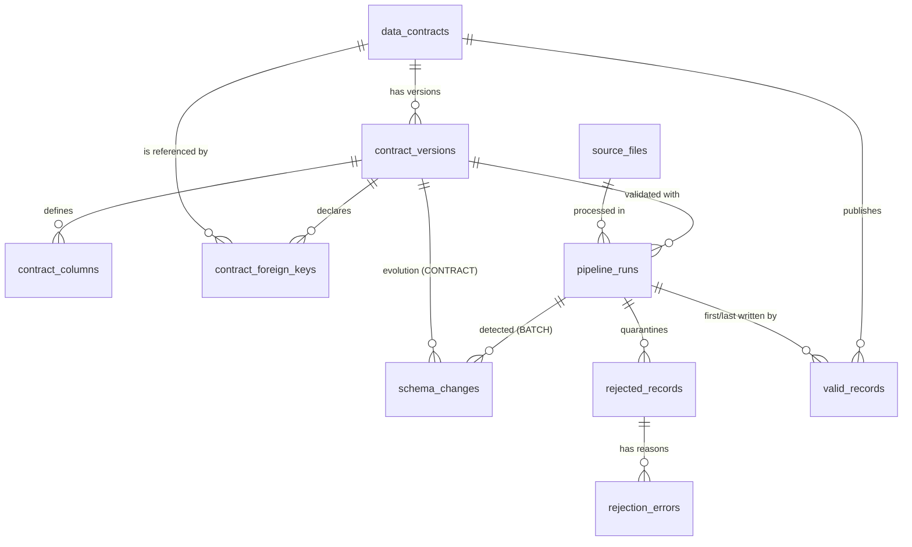

# Data Dictionary

MySQL 8, `utf8mb4`. All timestamps are `DATETIME(3)` in **UTC** (naive). Every table is
created by `scripts/init_db.py` / application startup from the SQLAlchemy models in
`backend/models/`.

## Relationships

Legend: **PK** primary key · **FK** foreign key · **UQ** unique · **IX** index · NN not null.

---

## data_contracts

One logical contract per dataset.

| Column | Type | Null | Key | Description |
|---|---|---|---|---|
| id | INT AUTO_INCREMENT | NN | PK | Contract ID |
| name | VARCHAR(150) | NN | | Display name |
| dataset_name | VARCHAR(100) | NN | UQ | Dataset identifier (`^[A-Za-z_][A-Za-z0-9_]*$`) |
| description | TEXT | null | | |
| owner | VARCHAR(100) | null | | Owning team |
| created_at / updated_at | DATETIME(3) | NN | | `updated_at` changes when a new version is added |

Business rules: one contract per `dataset_name`. A contract is never deleted while runs
reference it (FK `RESTRICT`).

## contract_versions

Immutable versions. Edits always create `version + 1`.

| Column | Type | Null | Key | Description |
|---|---|---|---|---|
| id | INT | NN | PK | |
| contract_id | INT | NN | FK → data_contracts.id, UQ(contract_id, version) | |
| version | INT | NN | | 1, 2, 3 … |
| compatibility_mode | VARCHAR(20) | NN | | `BACKWARD` (default) or `STRICT` |
| event_time_column | VARCHAR(100) | null | | Column ordering events (late / out-of-order handling) |
| unique_constraints | JSON | NN | | `[[col, …], …]`: business-event keys, unique within a batch |
| business_rules | JSON | NN | | Declarative rules: `compare_columns`, `product_equals`, `not_in_future` |
| change_notes | TEXT | null | | |
| created_by | VARCHAR(100) | null | | |
| created_at | DATETIME(3) | NN | | Creation timestamp |

The primary key is derived from `contract_columns.is_primary_key` (in ordinal order).

## contract_columns

| Column | Type | Null | Key | Description |
|---|---|---|---|---|
| id | INT | NN | PK | |
| version_id | INT | NN | FK → contract_versions.id (CASCADE), UQ(version_id, name) | |
| name | VARCHAR(100) | NN | | Column name |
| ordinal | INT | NN | | Position |
| data_type | VARCHAR(20) | NN | | `string`, `integer`, `float`, `decimal`, `boolean`, `date`, `timestamp` |
| required | BOOLEAN | NN | | The column must be present in the batch |
| nullable | BOOLEAN | NN | | Values may be NULL |
| is_primary_key | BOOLEAN | NN | | PK columns must be required and non-nullable |
| allowed_values | JSON | null | | Enum list |
| default_value | JSON | null | | Applied when the column is absent or the value is NULL |
| min_value / max_value | DOUBLE | null | | Numeric bounds |
| max_length | INT | null | | String length |
| pattern | VARCHAR(255) | null | | Regex (full match) |
| normalize | VARCHAR(10) | null | | `lower` / `upper`: explicit permission to normalise case |
| renamed_from | VARCHAR(100) | null | | Compatibility mapping for a renamed column |
| description | VARCHAR(255) | null | | |

## contract_foreign_keys

| Column | Type | Null | Key | Description |
|---|---|---|---|---|
| id | INT | NN | PK | |
| version_id | INT | NN | FK → contract_versions.id (CASCADE), UQ(version_id, column_name) | |
| column_name | VARCHAR(100) | NN | | Child column |
| ref_contract_id | INT | NN | FK → data_contracts.id | Parent dataset |
| ref_column | VARCHAR(100) | NN | | Must equal the parent's single-column PK |

Rule: the referenced value must exist in the parent's **published** `valid_records`.

## source_files

One row per distinct file content.

| Column | Type | Null | Key | Description |
|---|---|---|---|---|
| id | INT | NN | PK | |
| file_name | VARCHAR(255) | NN | | Name at first upload |
| stored_path | VARCHAR(500) | NN | | Original bytes, saved as `<UPLOAD_DIR>/<sha256>.<ext>` |
| checksum_sha256 | CHAR-like VARCHAR(64) | NN | UQ | Content identity |
| file_format | VARCHAR(10) | NN | | `csv` / `json` |
| file_size_bytes | BIGINT | NN | | |
| uploaded_at | DATETIME(3) | NN | | |

## pipeline_runs

One row per execution attempt.

| Column | Type | Null | Key | Description |
|---|---|---|---|---|
| id | INT | NN | PK | Internal id |
| run_id | VARCHAR(40) | NN | UQ | Public id, e.g. `RUN-20261110-061516-2b6e45` |
| contract_id | INT | NN | FK → data_contracts.id | |
| contract_version_id | INT | NN | FK → contract_versions.id | Version the batch was validated against |
| source_file_id | INT | NN | FK → source_files.id | |
| source_file_name | VARCHAR(255) | NN | | Name as uploaded for this run |
| source_system | VARCHAR(100) | null | | Producer system |
| idempotency_key | VARCHAR(64) | NN | IX(idempotency_key, status) | sha256(checksum \| contract_version_id) |
| attempt | INT | NN | | 1, then +1 per retry |
| force_reprocess | BOOLEAN | NN | | Bypasses the duplicate-batch check |
| duplicate_of_run_id | VARCHAR(40) | null | | Set for `SKIPPED_DUPLICATE` |
| status | VARCHAR(30) | NN | IX | `PENDING`, `RUNNING`, `COMPLETED`, `COMPLETED_WITH_ERRORS`, `FAILED`, `SKIPPED_DUPLICATE` |
| started_at / ended_at | DATETIME(3) | null | | |
| duration_ms | INT | null | | Processing duration |
| input_count | INT | NN | | Rows in the file |
| valid_count / rejected_count | INT | NN | | |
| published_count | INT | NN | | inserted + updated |
| inserted_count / updated_count | INT | NN | | |
| unchanged_count | INT | NN | | Identical re-deliveries (no write) |
| stale_skipped_count | INT | NN | | Older event than the published one (not applied) |
| late_arriving_count | INT | NN | | Event time earlier than the dataset watermark before this run |
| schema_change_count / breaking_change_count / non_breaking_change_count | INT | NN | | |
| failure_reason | TEXT | null | | Human-readable cause of FAILED / SKIPPED |
| transformation_summary | JSON | null | | Renames, defaults applied, values normalised, stage timings |
| created_at / updated_at | DATETIME(3) | NN | IX(created_at) | |

## schema_changes

| Column | Type | Null | Key | Description |
|---|---|---|---|---|
| id | INT | NN | PK | |
| scope | VARCHAR(10) | NN | | `BATCH` (file vs contract) or `CONTRACT` (version N vs N-1) |
| run_id | INT | null | FK → pipeline_runs.id (CASCADE), IX | Set for BATCH scope |
| contract_version_id | INT | NN | FK → contract_versions.id | |
| change_type | VARCHAR(50) | NN | | e.g. `MISSING_REQUIRED_COLUMN`, `TYPE_CHANGED`, `ALLOWED_VALUES_ADDED` |
| column_name | VARCHAR(100) | null | | |
| old_schema / new_schema | JSON | null | | Contract spec vs observed / proposed spec |
| severity | VARCHAR(10) | NN | | `INFO`, `WARNING`, `CRITICAL` |
| classification | VARCHAR(15) | NN | IX | `BREAKING` / `NON_BREAKING` |
| explanation | TEXT | NN | | Why it was classified this way |
| detected_at | DATETIME(3) | NN | | |

## valid_records

Published target data.

| Column | Type | Null | Key | Description |
|---|---|---|---|---|
| id | BIGINT | NN | PK | |
| contract_id | INT | NN | FK, **UQ(contract_id, record_key)**, IX(contract_id, primary_key_value) | |
| contract_version_id | INT | NN | FK | Version that last wrote the row |
| record_key | VARCHAR(64) | NN | | sha256(contract_id \| PK value): deterministic identity |
| primary_key_value | VARCHAR(255) | NN | | Readable PK (`ORD-000001`, composite joined by `\|`) |
| payload | JSON | NN | | Transformed record restricted to contract columns (ISO-8601 timestamps) |
| record_hash | VARCHAR(64) | NN | | sha256 of the stored payload JSON (change detection) |
| event_ts | DATETIME(3) | null | | Value of the contract's event-time column |
| source_file_id | INT | NN | FK | Lineage |
| source_row_number | INT | NN | | Lineage (1-based data row) |
| first_run_id / last_run_id | INT | NN | FK → pipeline_runs.id | Lineage |
| created_at / updated_at | DATETIME(3) | NN | | |

Rules: a row is only replaced by an event with `event_ts >=` the stored one; identical
payloads are not rewritten.

## rejected_records

Quarantine.

| Column | Type | Null | Key | Description |
|---|---|---|---|---|
| id | BIGINT | NN | PK | |
| run_id | INT | NN | FK → pipeline_runs.id (CASCADE), UQ(run_id, source_row_number) | |
| source_file_id | INT | NN | FK | |
| contract_version_id | INT | NN | FK | |
| source_row_number | INT | NN | | 1-based data row (CSV header excluded) |
| original_record | JSON | NN | | Row exactly as received (`_raw_fields` for unparseable rows) |
| error_codes | JSON | NN | | Distinct codes, for display |
| error_count | INT | NN | | |
| rejected_at | DATETIME(3) | NN | | |

## rejection_errors

One row per error, so quarantine can be filtered by error type.

| Column | Type | Null | Key | Description |
|---|---|---|---|---|
| id | BIGINT | NN | PK | |
| rejected_record_id | BIGINT | NN | FK → rejected_records.id (CASCADE) | |
| run_id | INT | NN | FK, IX(run_id, error_code) | Denormalised for fast filtering |
| error_code | VARCHAR(50) | NN | IX | See below |
| column_name | VARCHAR(100) | null | | |
| message | VARCHAR(500) | NN | | Human-readable reason |
| observed_value | VARCHAR(255) | null | | Raw offending value |

### Error codes

| Code | Meaning |
|---|---|
| MALFORMED_ROW | Row could not be parsed (wrong field count, non-object JSON item) |
| NULL_NOT_ALLOWED | NULL in a non-nullable column |
| INVALID_TYPE | Not convertible to the declared type |
| INVALID_TIMESTAMP | Not a valid timestamp/date |
| INVALID_ALLOWED_VALUE | Not in `allowed_values` |
| VALUE_BELOW_MIN / VALUE_ABOVE_MAX | Numeric bounds violated |
| VALUE_TOO_LONG | String longer than `max_length` |
| PATTERN_MISMATCH | Regex not matched |
| DUPLICATE_PRIMARY_KEY | PK repeated in the batch (first occurrence kept) |
| DUPLICATE_BUSINESS_EVENT | Unique business key repeated in the batch |
| FOREIGN_KEY_VIOLATION | Parent record not published |
| BUSINESS_RULE_VIOLATION | Cross-field rule failed |
| FUTURE_TIMESTAMP | Later than now + tolerance |

## Demo domain contracts

**customers** (PK `customer_id` `^CUST-\d{5}$`):
`full_name`, `email` (lower-cased, regex, unique), `country` ∈ {IN, US, GB, DE, SG},
`segment` ∈ {RETAIL, SMB, ENTERPRISE} (optional, default RETAIL), `signup_ts`, `updated_ts`
(event time). Rules: `updated_ts ≥ signup_ts`; `signup_ts` not in the future.

**orders** (PK `order_id` `^ORD-\d{6,}$`):
`customer_id` (FK → customers), `product_id`, `quantity` 1–1000, `unit_price` 0–100000,
`total_amount ≥ 0`, `currency` ∈ {INR, USD, EUR, GBP}, `status` ∈ {PLACED, PAID, SHIPPED,
DELIVERED, CANCELLED}, `order_ts`, `ship_ts` (optional), `updated_ts` (event time), `channel`
(optional). Unique business event: (customer_id, product_id, order_ts). Rules:
- `total_amount = quantity × unit_price ± 0.01`
- `ship_ts ≥ order_ts`
- `updated_ts ≥ order_ts`
- `order_ts` not in the future
